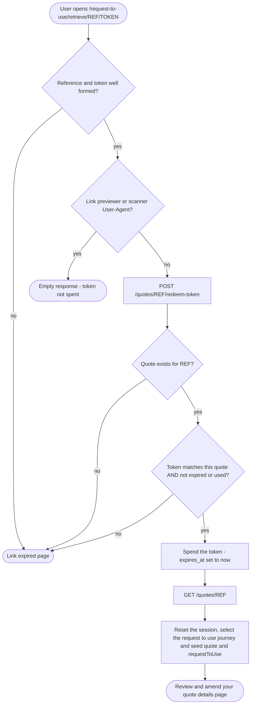

# Retrieve a saved quote — flows

How a user asks for a magic link and then follows it back to their quote
(NRF2-1256).

## Requesting the email

```mermaid
flowchart TD
  start([User submits the enter your email address page]) --> hasref{Saved NRL reference in the session?}
  hasref -- no --> startpage([Start page])
  hasref -- yes --> call[POST /quotes/email-quote-link with reference and email]

  call --> err{Backend error?}
  err -- yes --> errorpage([Standard error page])
  err -- no --> match{Quote exists AND email matches its owner, ignoring case?}

  match -- no --> keep[Keep the answers, save the submitted email]
  keep --> notmatched([These details do not match our records page])

  match -- yes --> token[Issue a 24 hour single-use token, expiring any earlier one]
  token --> send[Send the retrieve your quote email]
  send --> clear[Clear the journey sessions, save the submitted email]
  clear --> confirmation([We have sent you an email page])
```

## Opening the magic link



> **Notify failures look like success.** If Notify rejects the send, the backend
> logs it, records the notification without a Notify id for the later retry, and
> still responds as matched, so an error cannot reveal that a quote matched.
>
> **Used and timed-out links look the same.** Redemption sets `expires_at` to now,
> so a second use of a link, a link older than 24 hours and a link replaced by a
> newer one all end at the link expired page. A bad or mismatched token ends there
> too.
>
> **Latest link wins.** Issuing a token expires any live token for the quote, so
> asking for another email makes the earlier link stop working.
>
> **Link expired and review pages are not built yet.** Both redirects 404 until
> NRF2-1257/1264 and NRF2-1259 land.
