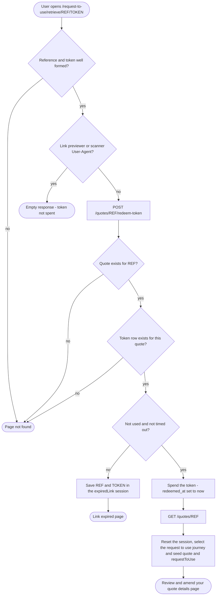

# Retrieve a saved quote — flows

How a user asks for a magic link, follows it back to their quote, and asks for a
new one when theirs has expired (NRF2-1256, NRF2-1257).

## Requesting the email

```mermaid
flowchart TD
  start([User submits the enter your email address page]) --> hasref{Saved NRL reference in the session?}
  hasref -- no --> startpage([Start page])
  hasref -- yes --> call[POST /quotes/email-quote-link with reference and email]

  call --> err{Backend error?}
  err -- yes --> errorpage([Standard error page])
  err -- no --> match{Quote exists AND email matches its owner, ignoring case?}

  match -- no --> keep[Keep the answers, save the submitted email]
  keep --> notmatched([These details do not match our records page])

  match -- yes --> token[Issue a 24 hour single-use token, expiring any earlier one]
  token --> send[Send the retrieve your quote email]
  send --> clear[Clear the journey sessions, save the submitted email]
  clear --> confirmation([We have sent you an email page])
```

## Opening the magic link



## Requesting a new link

```mermaid
flowchart TD
  start([User submits the request a new link form on the link expired page]) --> session{expiredLink in the session?}
  session -- no --> notfound([Page not found])
  session -- yes --> call[POST /quotes/REF/resend-link with TOKEN]

  call --> err{Backend error?}
  err -- yes --> errorpage([Standard error page])
  err -- no --> match{Token is a spent token for this quote?}

  match -- no --> notfound
  match -- yes --> issue[Issue a 24 hour single-use token, expiring any earlier one]
  issue --> send[Send the retrieve your quote email]
  send --> save[Clear expiredLink, save the returned address as retrieveQuote.email]
  save --> confirmation([We have sent you an email page])
```

> **Notify failures look like success.** If Notify rejects the send, the backend
> logs it, records the notification without a Notify id for the later retry, and
> still responds as matched, so an error cannot reveal that a quote matched.
>
> **Used and timed-out links look the same.** A second use of a link, a link older
> than 24 hours and a link replaced by a newer one all end at the link expired
> page, where the user can ask for a new link.
>
> **Unknown and tampered links look the same.** A malformed link, an unknown
> reference and a wrong token all show page not found, so a visitor cannot tell
> whether a quote exists. There is no way to ask for a new link from there.
>
> **The old token is the proof.** `resend-link` returns the address the email went
> to, which is only safe because the caller holds a spent token for that quote. A
> reference alone never reveals it.
>
> **Latest link wins.** Issuing a token expires any live token for the quote, so
> asking for another email makes the earlier link stop working.
