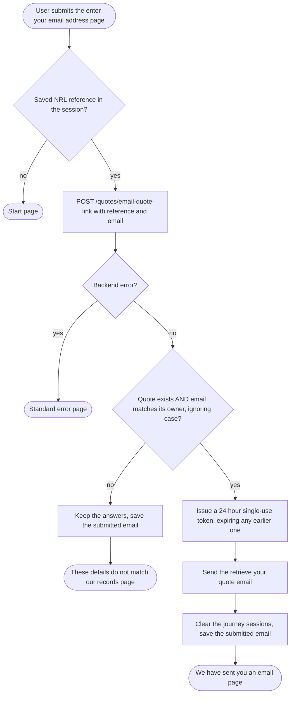
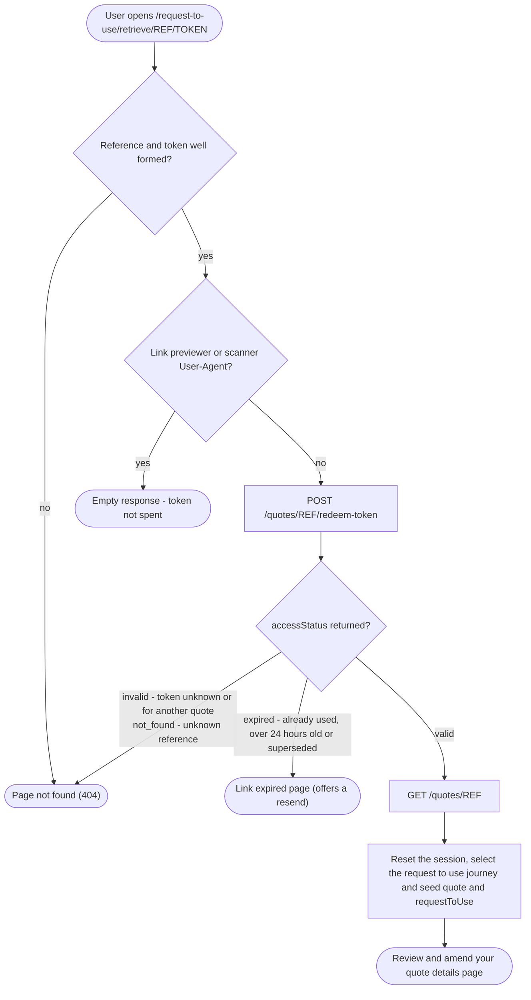

# Retrieve a saved quote — flows

How a user asks for a magic link and then follows it back to their quote
(NRF2-1256).

## Requesting the email

## Opening the magic link

> **Notify failures look like success.** If Notify rejects the send, the backend
> logs it, records the notification without a Notify id for the later retry, and
> still responds as matched, so an error cannot reveal that a quote matched.
>
> **Used and timed-out links look the same.** Redemption stamps `redeemed_at`,
> so a second use of a link, a link older than 24 hours and a link replaced by a
> newer one all end at the link expired page, which offers a resend. A bad or
> mismatched token, or an unknown reference, renders the page not found page.
>
> **Latest link wins.** Issuing a token expires any live token for the quote, so
> asking for another email makes the earlier link stop working.
